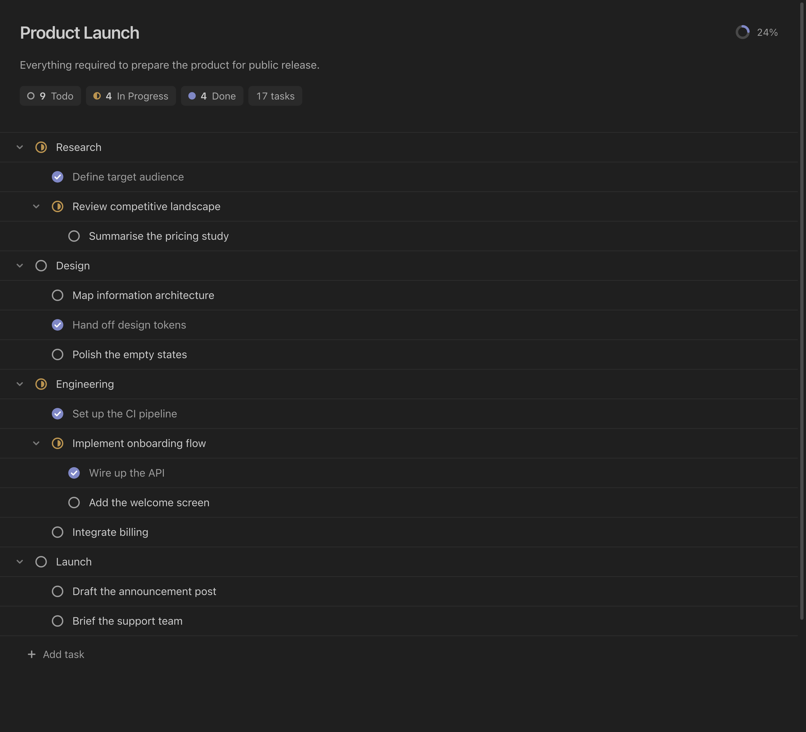

# Plan: .pln Editor

Edit project plans as interactive task lists instead of raw Markdown. A `.pln`
file uses Markdown-style checkboxes: each checkbox line is a task with three
states — todo, in progress, and done. Indentation defines nested subtasks.

Your plan stays in plain text, so it can be tracked, diffed, and merged like any
other file in your repository. The editor uses **targeted edits** rather than
rewriting the entire file. Formatting outside the edited ranges — including
indentation, bullet markers (`-`, `*`, `+`), blank lines, and line endings — is
preserved. When adding subtasks, the editor matches the indentation and bullet
style of existing siblings when possible.



## Example

```markdown
# Product Launch
Everything required to prepare the product for public release.

- [-] Research
  - [x] Define target audience
  - [-] Review competitive landscape
    - [ ] Summarise the pricing study
- [ ] Launch
  - [ ] Draft the announcement post
```

`[ ]` means todo, `[-]` means in progress, and `[x]` or `[X]` means done. The
`#` heading is the project title, and the following line is the project
description.

Task lists use standard Markdown checkbox syntax, keeping the file readable in
GitHub, plain-text editors, and other Markdown viewers. HTTP(S) links in plan
and task descriptions are clickable in the editor.

Relative Markdown links, such as `[auth](src/auth.ts)`, remain portable
references in the file, but in-editor navigation to files or specific lines is
not yet supported. Use **Open as Markdown** when you need native Markdown
editing and navigation.

A status change modifies only the checkbox marker:

```diff
- - [ ] Draft the announcement post
+ - [x] Draft the announcement post
```

## Install

Search for **Plan: .pln Editor** in the VS Code Extensions view, or install it
from the
[VS Code Marketplace](https://marketplace.visualstudio.com/items?itemName=CIME-Technologies.pln-editor).

For Cursor and other compatible editors, find **Plan: .pln Editor** on
[Open VSX](https://open-vsx.org/extension/CIME-Technologies/pln-editor).

## Usage

Create or open a file ending in `.pln` to open it in the plan editor. Use the
title-bar **Open as Markdown** action to switch to the native text editor, or
**Open as Plan** to return to the visual editor. **Reopen Editor With…** also
lets you switch editors.

Git/SCM diffs use the native text editor by default through
`workbench.editorAssociations` for `git:` / `gitlens:` `.pln` URIs.

- **Add a task** using the *Add task* button at the bottom. Its name is selected
  so you can type immediately.
- **Add a subtask** using the `+` button that appears when you hover over a
  task. The new subtask is placed after that task’s existing descendants.
- **Change status** by clicking a task’s circle to cycle through todo → in
  progress → done. Use the task menu (`⋯`) to set a status directly. Parents
  with subtasks show a display-only count such as `2/5` (completed direct
  subtasks / total). It does not change the file or the parent’s own status.
- **Rename** by clicking a task title, project title, or project description.
  Clearing a task title keeps the task and displays **Untitled**. Clearing the
  project title removes the `#` heading and displays **Untitled**.
- **Delete** a task from the `⋯` menu. Deleting a task with subtasks requires
  confirmation and removes the entire branch.
- **Collapse** a task using its chevron. Collapsed tasks are remembered per
  file.

## Early release

This is an early release. The editor supports tasks, subtasks, statuses,
renaming, and deletion. Other content in a `.pln` file is left untouched but is
not displayed in the visual editor.

Editing a task description rewrites that description block using its existing
indentation where available. Formatting elsewhere in the file is preserved.

Issues and feedback: <https://github.com/CIME-Technologies/pln/issues>

## Development

```bash
npm install
npm test
npm run check
npm run compile
```

To launch the extension locally, open the project in VS Code and press F5
(or **Run and Debug → Run Extension**).

## License

MIT
